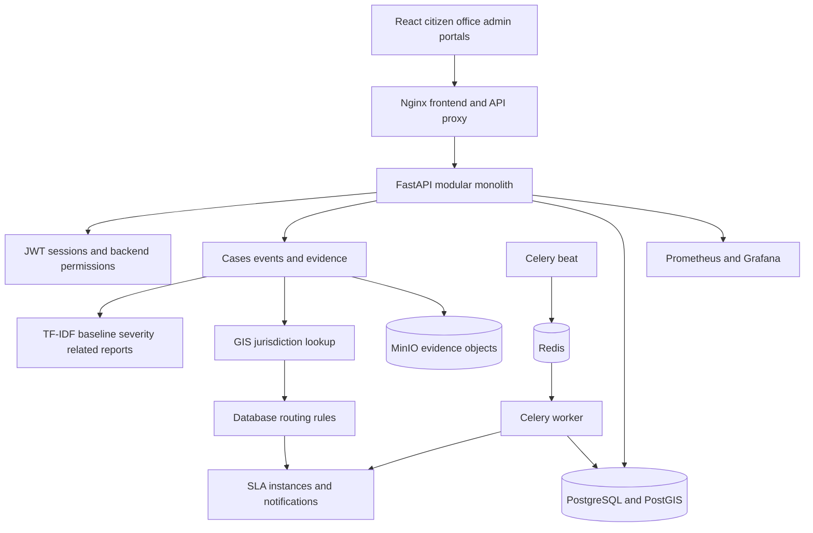
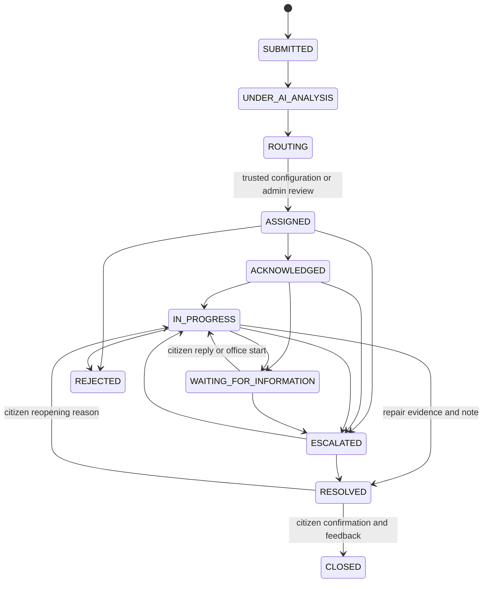
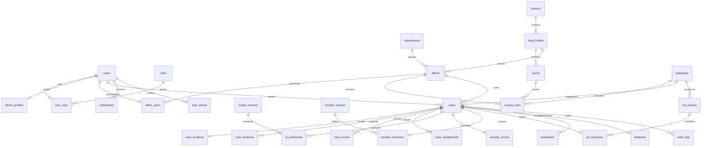

# Architecture and database design

JANASEVA is a modular monolith. React calls a REST API through Nginx. SQLAlchemy persists normalized records in PostgreSQL. PostGIS covers geometry lookup and distance candidates. Redis supports distributed rate limits and Celery scheduling. MinIO stores evidence objects. Portable local mode substitutes SQLite, Shapely point-in-polygon and local files so the same APIs can be exercised without infrastructure.

## Transaction boundaries

Complaint submission allocates a public counter ID, creates the case, evaluates AI/GIS/routing, starts the SLA and writes events/notifications within one database transaction. The public counter uses atomic INSERT ON CONFLICT UPDATE RETURNING. Internal UUIDs remain separate. PostgreSQL case actions lock the case row to avoid concurrent invalid transitions. SLA rows use skip-locked background processing. Individual citizen reports remain intact when linked to an incident cluster.

Object uploads use a separate object-store transaction. If a database commit fails after storage, an orphan object may remain. A production retention/cleanup worker and malware scanner are recommended; the MVP rejects unsupported and active file formats but does not claim a complete malware scan.

## Controlled states

The exhaustive transition matrix is in `backend/app/services/states.py`. Status changes generate case events and audit records. DRAFT exists in the model for future draft persistence; the citizen UI submits completed forms directly.

## Entity relationships

## Schema details

All identity/entity keys use UUID strings, with foreign keys and domain constraints. Human case IDs have a unique indexed column. The user-role relationship permits exactly one role per user. Case locations constrain coordinate ranges and use SRID 4326 Point geometry. Ward geometry uses MultiPolygon with a spatial index in PostgreSQL. Operational indexes cover citizen, office, status, category, case events, memberships and SLA deadlines. Password hashes never appear in API output. Identity and complaint evidence are separate tables.

Audit/event mutation triggers are installed by Alembic for PostgreSQL and SQLite. They protect normal database actions, while a database superuser can still bypass/drop triggers. Use a separate migration owner and a least-privilege runtime database role for a real deployment.

The initial migration carries an immutable schema snapshot. Runtime model changes must become new reviewed migrations, with downgrade validation on disposable databases.
