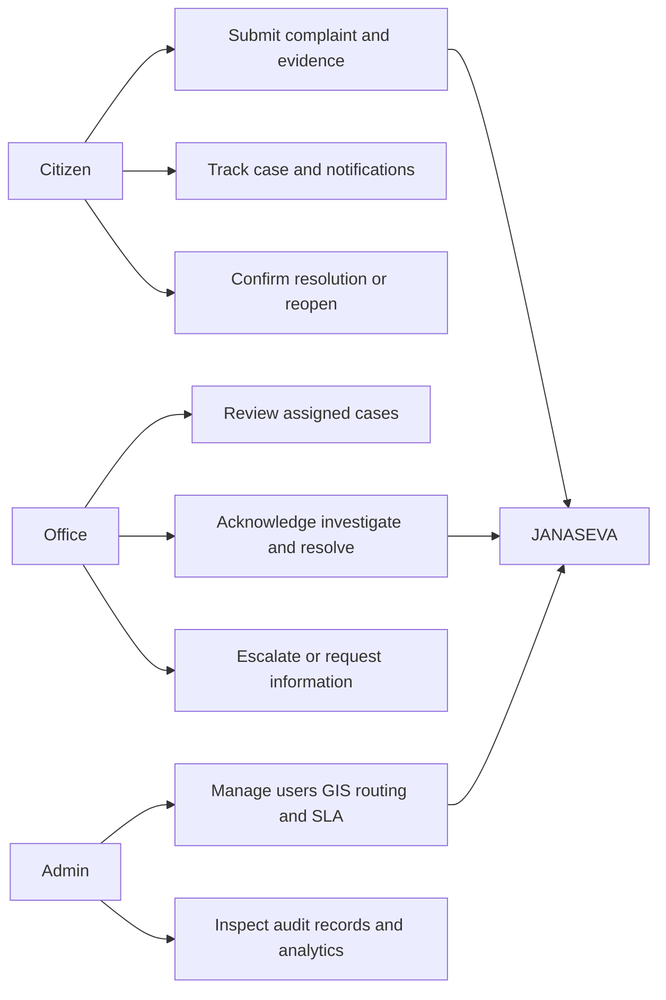
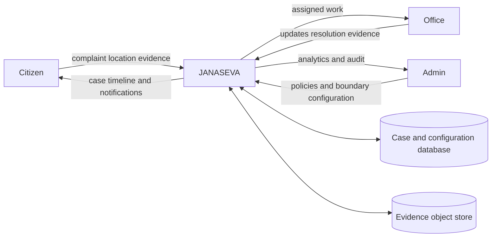
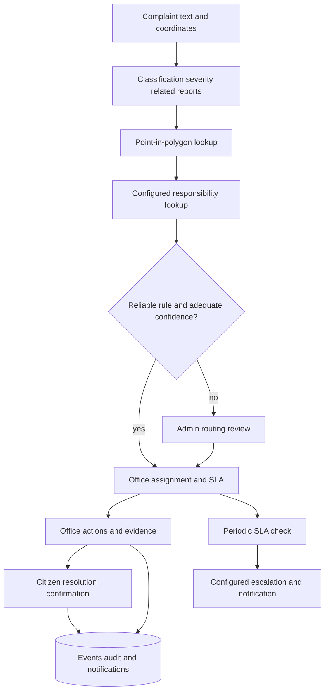
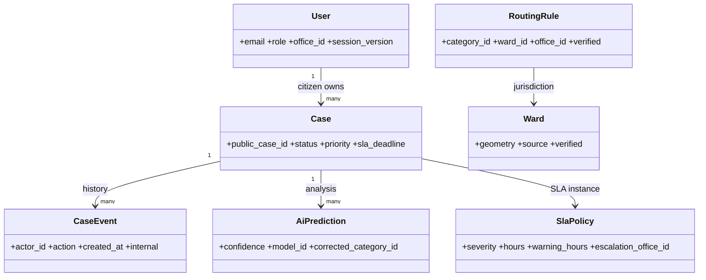
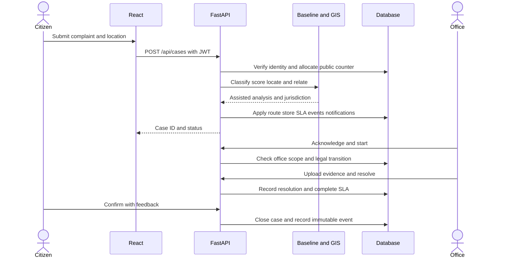
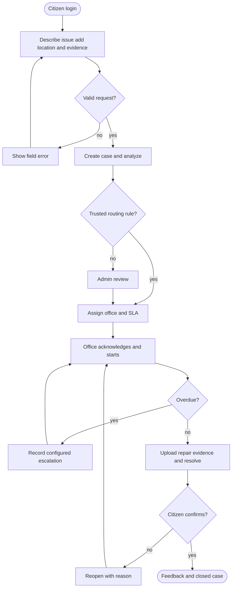

# System diagrams

These editable Mermaid definitions accompany the architecture and ER diagram in ARCHITECTURE.md. Render in a Mermaid-capable editor or Markdown viewer.

## Use cases

## Data flow level 0

## Data flow level 1

## Class diagram

## Sequence diagram

## Activity diagram

